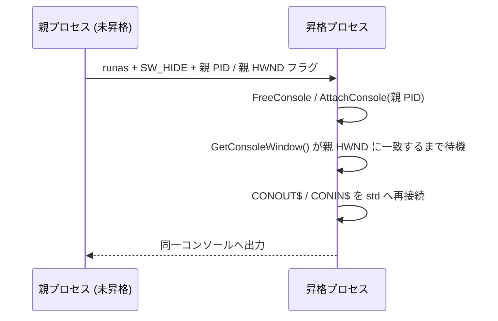

# console - Windows コンソール設定ヘルパー

`console` は、Windows と Linux の両方で同一の呼び出しコードを使用できるコンソール初期化ユーティリティです。

## 目的

Windows 10 1903 以降では、`activeCodePage=UTF-8` マニフェストによりプロセスの ANSI コード ページ (ACP) を UTF-8 に設定できます。これにより、`argv`、CRT narrow API、Win32 `-A` API を UTF-8 を前提として扱えます。

一方、接続先コンソールにはプロセス ACP とは別に入力コード ページと出力コード ページがあります。このモジュールは、Windows のコンソール設定をアプリケーションの UTF-8 前提に合わせ、ANSI エスケープ シーケンスによる色やカーソル制御を利用できるように設定します。

- コンソール入力コード ページを UTF-8 に設定
- コンソール出力コード ページを UTF-8 に設定
- stdout / stderr の Virtual Terminal Processing を有効化
- Linux では `cplat_console_init` / `cplat_console_dispose` は no-op

## 設計の要点

このモジュールは、CRT の `printf` / `fprintf` を置き換えません。stdout または stderr がコンソール (TTY) である場合にのみ、接続先コンソールの状態を確認し、必要な設定を行います。

- すでに UTF-8 のコード ページは変更しません。
- 変更前のコード ページとコンソール モードは保存し、通常終了時に復元します。
- stdout と stderr の両方をパイプやファイルへリダイレクトした場合は、初期化処理を行いません。
- stdout だけをリダイレクトした場合は、コンソールのままの stderr のためにコード ページを変更し、stderr の VT 処理を有効化します。
- `cplat_console_init` は stdin / stdout / stderr のハンドルを変更しません (昇格時の再接続は `cplat_console_attach_parent` が担当します)。

`activeCodePage=UTF-8` マニフェストはプロセス ACP を UTF-8 にする設定です。コンソールの入力コード ページ / 出力コード ページは別の状態であるため、このモジュールでは `SetConsoleCP(CP_UTF8)` / `SetConsoleOutputCP(CP_UTF8)` を引き続き使用します。

## 代表 API

### cplat_console_init

コンソール ヘルパーを初期化します。

- Windows ではコンソール入出力コード ページと VT 処理を設定します。
- Linux では何もしません。
- 二重呼び出し時は追加の初期化を行いません。
- stdout と stderr のいずれもコンソールでない場合は何もしません。

### cplat_console_dispose

コンソール ヘルパーを終了し、変更した状態を元に戻します。

- Windows では変更前のコンソール入出力コード ページとコンソール モードを復元します。
- Linux では何もしません。
- 未初期化時や複数回呼び出し時でも安全に動作します。
- 通常はライブラリ アンロード時の自動解放に任せられます。

### cplat_console_attach_parent

昇格起動された場合に、親プロセスのコンソールへ再接続します。

- Windows では `cplat_elevated_process_run_if_needed` が UAC 昇格で自プロセスを再起動した際に付与する引き継ぎフラグを検出します。
- `AttachConsole` で親コンソールへ接続し、stdin / stdout / stderr を親コンソール (CONIN$ / CONOUT$) へ再割り当てします。
- 検出したフラグは `argv` から取り除き、`argc` を 1 減らします。
- Linux では何もせず `CPLAT_OK` を返し、`attached_out` が NULL でなければ 0 を格納します。
- プログラム開始直後、引数解析および `cplat_console_init` より前に呼び出します。

この関数は次の仕組みで昇格プロセスの出力を元のコンソールに表示します。UAC 昇格 (`ShellExecuteExW` の `runas` 動詞) では昇格プロセスを別セキュリティ コンテキストで生成するため、親のハンドルを継承できません。そこで親プロセス ID と親コンソールの window ハンドルをコマンド ラインで渡し、昇格プロセス側が親コンソールへ接続し直します。親側は昇格プロセスの一時コンソールを隠して起動するため、別ウインドウは表示されません。



CodeBlock: 昇格時のコンソール引き継ぎ

昇格直後は、子プロセスの一時コンソール (conhost) の割り当てが非同期に進みます。子プロセスが独自の一時コンソールへ接続されたままの瞬間に `AttachConsole` を呼び出すと `ERROR_ACCESS_DENIED` で失敗します (`AttachConsole` は呼び出し元がすでにコンソールへ接続済みである場合に失敗します)。この失敗時は標準ハンドルの付け替えを行わず、かつ直前に `FreeConsole` 済みであるため、子プロセスはどのコンソールにも接続されず出力先を喪失します。これを防ぐため、`FreeConsole` と `AttachConsole` を有界リトライし、割り当てが安定するまで数回試行します。通常は 1 回目または 2 回目で接続できます。

- 親コンソール接続: `FreeConsole()` と `AttachConsole()` を有界リトライし、親コンソールへ一度でも接続できるまで待機します。
- 親コンソール確認: 接続成功後、親 HWND が渡されている場合は `GetConsoleWindow()` が親 HWND に一致するまで有界リトライします。この段階では `FreeConsole()` を再度呼ばず、接続済みの親コンソールを保持します。全試行で一致しない場合でも、`AttachConsole()` 自体が成功していれば従来動作を下限として付け替えを続行します。
- 終了時ドレイン: 親コンソールへ再接続していた場合、終了時のフラッシュ後にコンソールへの同期 API (`GetConsoleScreenBufferInfo`) を 1 度呼び、直前の書き込みが conhost に処理されてからプロセスが終了するようにします。

これらのリトライはいずれも有界であり、確認に失敗してもコンソールへ接続されていれば従来動作を下限として付け替えを続行します。

### 既知の制限: 再接続後に書き込みが間欠的に拒否される

`AttachConsole` の成功と親 HWND の一致を確認した後でも、実機調査では `stdout` / `stderr` への書き込みが `ERROR_INVALID_HANDLE` で間欠的に失敗する事象を確認しています。原因は conhost 側にあると推測されますが特定できておらず、また書き込みの再試行でも解消しません (一度失敗すると再試行しても同一のエラーで失敗します)。`printf` / `fprintf` (FILE\* 経由) だけでなく `cplat_console_write()` (Win32 API を直接呼び出す) でも同様に発生します。

UAC 昇格後に確実に結果を表示したい場合は、`cplat_console_attach_parent()` によるコンソール再接続ではなく、`cplat_elevated_process_run_piped()` または `cplat_elevated_process_run_with_result()` (`app/cplat/prod/libsrc/cplat/runtime/README.md` 参照) を使用してください。どちらも昇格プロセスのコンソールに一切アクセスしません。前者は昇格プロセスの標準出力と標準エラー出力を無名パイプで、後者は結果メッセージを一時ファイル経由で、呼び出し元プロセス (常に未昇格で、自分自身の正常なコンソールを保持している) へ渡すため、この問題の影響を受けません。

再現調査時は、環境変数 `CPLAT_CONSOLE_ATTACH_DIAG=1` を設定すると `%TEMP%/cplat_console_attach.log` へ再接続の診断ログを追記できます。  
このログには `FreeConsole` / `AttachConsole` / `GetConsoleWindow` / `CONOUT$` オープン / `reopen` / 終了時ドレインの成否と `GetLastError()` を記録します。

### cplat_console_write

`printf` / `fprintf` (FILE\* 経由) を使わず、`stdout` / `stderr` へ文字列を直接書き込みます。

- Windows では `GetStdHandle` で取得した Win32 ハンドルへ `WriteConsoleA` (失敗時は `WriteFile` にフォールバック) で直接書き込む
- Linux では対象の fd へ `write()` で直接書き込む
- `printf` / `fprintf` (FILE\* 経由) は再接続後に書き込みを拒否することがあるため、`cplat_console_attach_parent()` が `attached_out` に 1 を格納した場合の出力は、本関数を使用すること

## 使い方

呼び出し側は OS ごとの `#ifdef` を記述せずに、同一のコードで利用できます。

```c
#include <cplat/console/console.h>
#include <stdio.h>

int main(void)
{
    char buf[256];

    cplat_console_init();

    printf("こんにちは\n");
    fprintf(stderr, "警告\n");

    if (fgets(buf, sizeof(buf), stdin) != NULL) {
        printf("input: %s", buf);
    }

    return 0;
}
```

`cplat_console_dispose()` は明示的に呼び出しても構いませんが、通常は必須ではありません。

## プラットフォームごとの動作

### Windows

- stdout または stderr がコンソールである場合にのみ初期化します。
- `SetConsoleCP(CP_UTF8)` / `SetConsoleOutputCP(CP_UTF8)` でコンソール入出力コード ページを UTF-8 にします。
- stdout / stderr のうちコンソールであるものの `ENABLE_VIRTUAL_TERMINAL_PROCESSING` を有効化します。
- 変更前の状態を通常終了時に復元します。

### Linux / 非 Windows

- `cplat_console_init` / `cplat_console_dispose` / 内部解放処理はいずれも no-op
- 呼び出し側は分岐不要

## 注意点

- Windows では `activeCodePage=UTF-8` マニフェストを併用してください。
- コード ページは接続先コンソール全体で共有する設定です。stdout だけをリダイレクトして実行した場合 (`cmd > out.txt` など) もコード ページを UTF-8 へ変更するため、同じコンソールを共有する子プロセスの出力も UTF-8 のコード ページに従います。これは cplat を利用するモジュールの制約です。
- `cplat_console_init` は stdout / stderr のハンドルを変更しません (昇格時の再接続は `cplat_console_attach_parent` を使用してください)。
- `cplat_console_attach_parent()` が `attached_out` に 1 を格納した場合、その後の `stdout` / `stderr` への出力は `printf` / `fprintf` ではなく `cplat_console_write()` を使用してください。
- UAC 昇格後に確実に結果を表示したい場合は、`cplat_console_attach_parent()` ではなく `cplat_elevated_process_run_piped()` または `cplat_elevated_process_run_with_result()` の使用を検討してください (前述の既知の制限)。
- Windows 10 1903 未満はサポート対象外です。

## 参考リンク

- Microsoft Learn: Use UTF-8 code pages in Windows apps  
  https://learn.microsoft.com/en-us/windows/apps/design/globalizing/use-utf8-code-page  
  確認日: 2026-06-01。
- Microsoft Learn: Console Code Pages  
  https://learn.microsoft.com/en-us/windows/console/console-code-pages  
  確認日: 2026-06-01。
- Microsoft Learn: SetConsoleOutputCP function  
  https://learn.microsoft.com/en-us/windows/console/setconsoleoutputcp  
  確認日: 2026-06-01。
